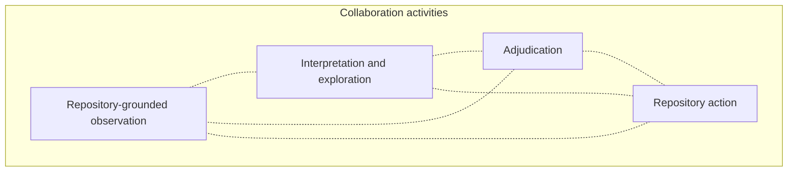

# Collaboration model and session continuity

**Status:** adopted collaboration principles; the topology diagram is a conceptual representation, not a prescribed workflow.

This document describes how the user and assistant collaborate on this repository, how different kinds of reasoning are kept distinct, and how work remains reconstructable across sessions. It is an epistemic and operational agreement, not a technical design for the plugin.

## Why this model is explicit

Repository work is conducted across sessions with limited per-session context. A later session may not have access to the full reasoning that led to the current position. The collaboration therefore cannot depend on conversational continuity or on an assistant reproducing an earlier session's conclusions.

The repository must preserve enough durable context for a new session to reconstruct the current working position, understand why important decisions were made, identify what remains open, and continue without treating missing context as permission to guess.

The purpose of ingress is to restore the conditions for productive reasoning—not to prescribe conclusions or reproduce every step of a previous conversation.

## Four interacting activities

The collaboration distinguishes four activities. They are useful distinctions, not sequential stages, exclusive roles, or a mandatory traversal.

### 1. Repository-grounded observation

Establish what the repository and its execution environment actually show.

This includes inspecting source, tests, documentation, dependencies, configuration, versioned history, issue/task records, and observed behaviour. Preserve provenance: distinguish what a source explicitly states from what a test demonstrates, what a tool reports, and what is inferred from those observations.

Repository-grounded observation is not limited to confirming an existing interpretation. It may expose contradictions, omissions, unexpected behaviour, or evidence that challenges an adopted explanation.

### 2. Interpretation and exploration

Identify patterns, make connections, formulate hypotheses, consider alternatives, and explore consequences.

This activity is deliberately open. It is not restricted to conclusions already documented in the repository or to the immediate wording of an active task. A useful interpretation may reveal that a requirement is incomplete, that an earlier explanation is weak, or that a different framing deserves investigation.

Exploratory contributions are not automatically repository facts or project decisions. Their evidential status must remain visible.

### 3. Adjudication

Examine interpretations and proposals against observed evidence, project intent, language and tool semantics, existing technical contracts, and the consequences of adopting them.

Adjudication may accept, reject, qualify, defer, or reopen an interpretation. It may lead back to further observation or exploration. Neither an earlier assistant conclusion nor a repository statement is immune from examination; equally, an attractive hypothesis does not become established merely through discussion.

A decision becomes project policy only when it is explicitly adopted and recorded in the appropriate authoritative artifact.

### 4. Repository action

Translate sufficiently adjudicated decisions into appropriately scoped repository changes: documentation, tests, code, issues, or other project records.

Repository action should preserve the distinction between adopted requirements and implementation choices. A change does not become correct merely because it is implemented or passes a test; validation must address the intended behaviour and relevant evidence.

Implementation and testing may also reveal new evidence or questions, feeding back into observation, interpretation, and adjudication.

## Relationship topology

The activities interact. The following flowchart represents their relationships without imposing a required order of traversal. The dotted, non-directional connections indicate observational or relational association, not a control-flow transition or a claim that one activity must follow another.

The diagram is intentionally modest. It distinguishes the activities and makes their interdependence visible; it does not attempt to encode every possible exchange, assign exclusive ownership, or prescribe a sequence. The prose definitions and the repository's technical/task contracts provide the relevant detail.

## Cross-cutting principles

### Interpretive freedom

Repository instructions, technical contracts, and task procedures constrain claims presented as established and changes made within their scope. They do not prohibit independent reasoning, hypothesis formation, alternative explanations, or constructive challenge.

A task-specific investigation procedure governs that task. It must not silently become a universal restriction on all reasoning in the repository.

### Epistemic separation

Keep these categories distinguishable:

- **Observation:** what a source, test, tool, or execution actually shows.
- **Established project decision:** a requirement or policy explicitly adopted and recorded in an authoritative project artifact.
- **Interpretation:** an explanation or reading of available evidence.
- **Hypothesis:** a proposition that may explain observations but remains to be tested.
- **Alternative:** another plausible interpretation or approach.
- **Proposal:** a suggested decision or change not yet adopted.

These categories may evolve: a hypothesis can be tested, an interpretation can be adjudicated, and a proposal can be adopted or rejected. Do not silently promote one category into another.

### Mutual challenge

The user and assistant may both question assumptions, evidence, and conclusions. Neither should merely mirror the other's latest statement. Disagreement should be reasoned and specific, with uncertainty and supporting evidence made visible. Corrections should improve shared understanding rather than unnecessarily narrow future exploration.

## Session continuity and ingress

### Session boundaries are expected

A session may end because of context limits, interruption, a change of task, or a deliberate handoff. The next session must not depend on access to the previous conversation.

The repository is the durable working environment. Documentation and ingress instructions are continuity surfaces: they preserve enough structure and provenance for a different observer, at a later time, to reconstruct the current position. They are not intended to preserve every conversational detail.

### What ingress must establish

A new session should, to the extent relevant to its task:

1. Identify the repository, current branch/ref, and available working state.
2. Read the repository ingress instructions and this collaboration model.
3. Identify the active task or issue and understand its actual scope and governing procedure.
4. Read the relevant technical contracts and authoritative project records.
5. Inspect the current implementation, tests, dependencies, and configuration needed to verify the reported position.
6. Separate established decisions and direct observations from interpretations, hypotheses, alternatives, and proposals.
7. Identify unresolved questions, known limitations, and the next useful action.
8. Avoid inheriting unverified assumptions or treating conversational summaries as authoritative evidence.

Ingress should be proportionate. It should direct a session to the relevant context, not require loading the entire repository or every historical discussion. When the correct next step is uncertain, inspect the governing records and evidence before asking the user to repeat information that may already be recorded.

### What a useful handoff preserves

When work materially changes the project position, or when a session is nearing its context limit, record a concise handoff in the appropriate durable location. It should preserve:

- the branch/ref and relevant repository state;
- the task or issue, its scope, and the current position within it;
- the files, tests, dependencies, or behaviours actually inspected;
- work completed and its evidence;
- decisions adopted and the rationale for them;
- interpretations, hypotheses, and proposals that remain provisional;
- unresolved questions, risks, limitations, and failed or inconclusive approaches;
- the exact next action and any assumptions the next session should avoid.

Record information in the artifact that owns it. Technical requirements belong in the technical design contract; task progress belongs in the task record; broader collaboration and ingress rules belong here and in `AGENTS.md`. Avoid duplicating full explanations across multiple documents. A handoff should point to authoritative records rather than create a competing source of truth.

### Continuity is not conclusion preservation

A new session should inherit the evidence, adopted decisions, open questions, and current work position—not an obligation to defend the previous session's interpretation. Reconstructability requires enough provenance to understand why the current position exists, while retaining the freedom to challenge it when new inspection or reasoning warrants doing so.

## Scope and authority

This document governs collaboration and session continuity. It does not supersede technical contracts such as [the design contract](design.md), nor does it replace task-specific scope and procedures. Where a task defines a particular investigation method, apply it within that task. If a conflict with an adopted project policy is found, make the conflict and its impact explicit and seek adjudication rather than silently overriding either source.

Related ingress instructions: [repository AGENTS.md](../AGENTS.md).
